<h1 align="center">Свадебный салон (1С:Предприятие)</h1>

  <i>Конфигурация для автоматизации учета в свадебном магазине: товары, клиенты и заказы.</i>

 

## Скриншоты

  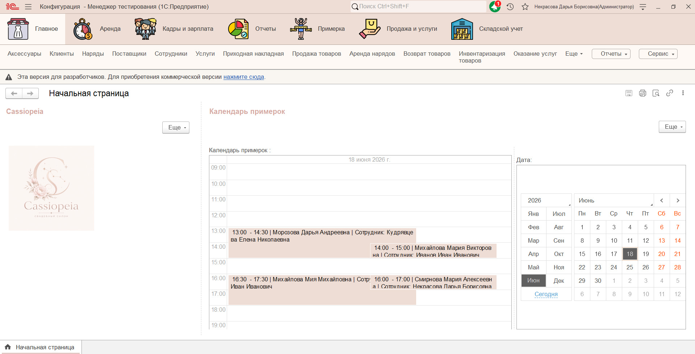
    

  <h3> Справочники</h3>
  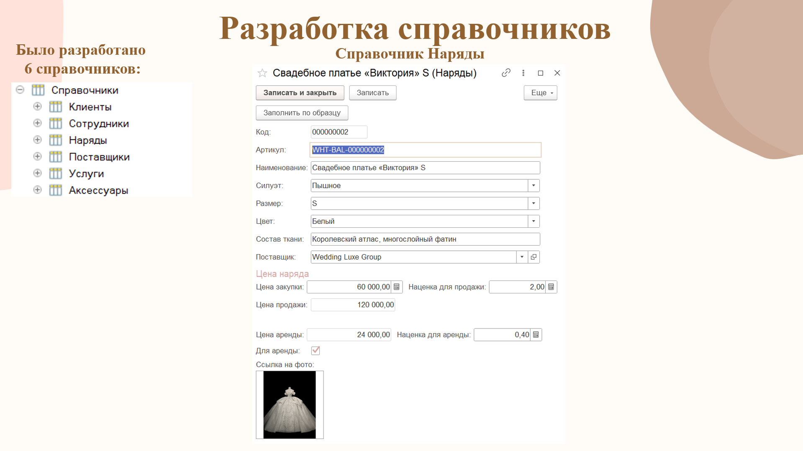
    
  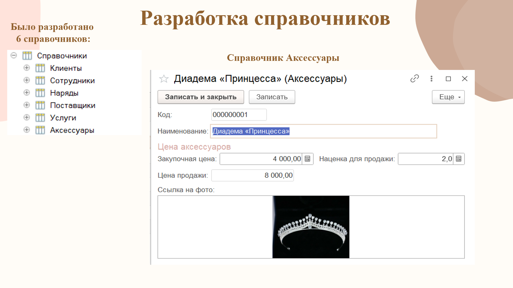
    
  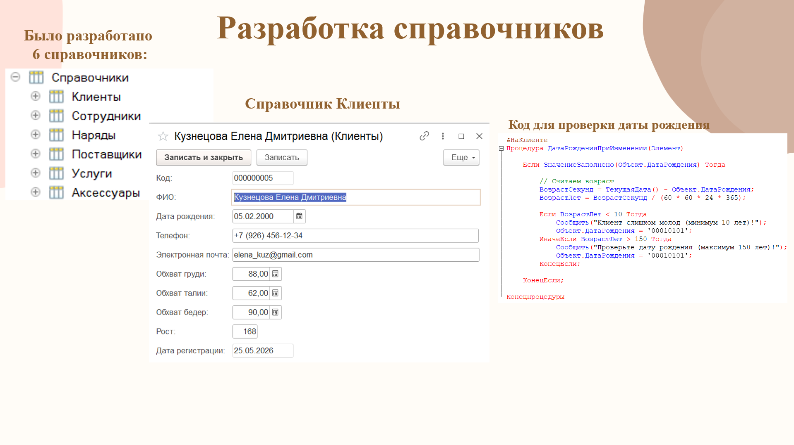
     

  <h3> Документы</h3>
  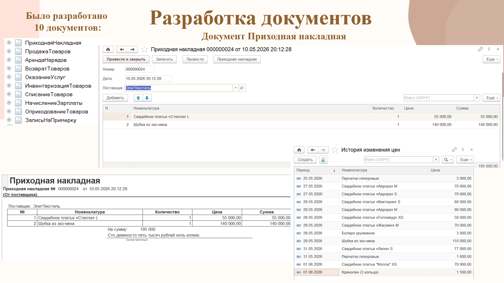
    
  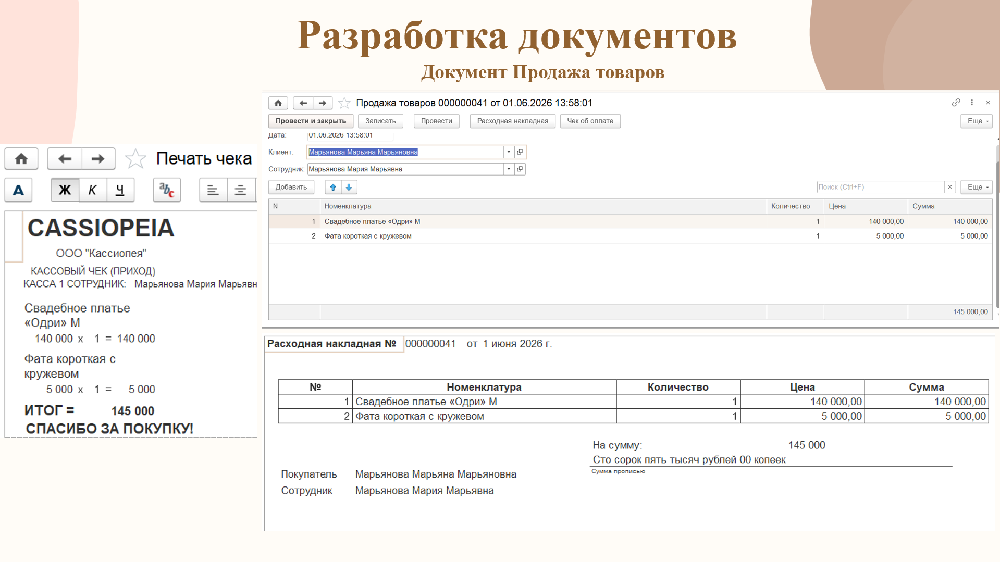
    
  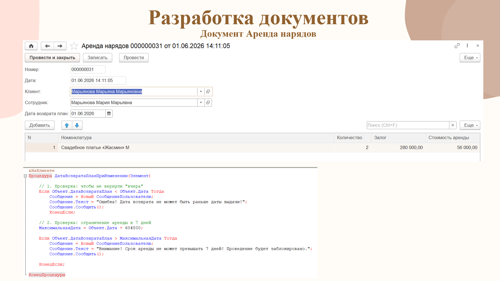
    
  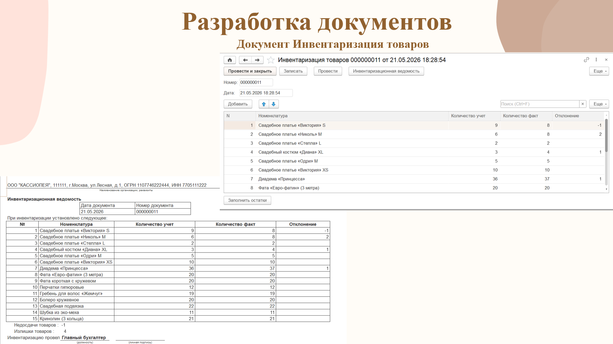
    
  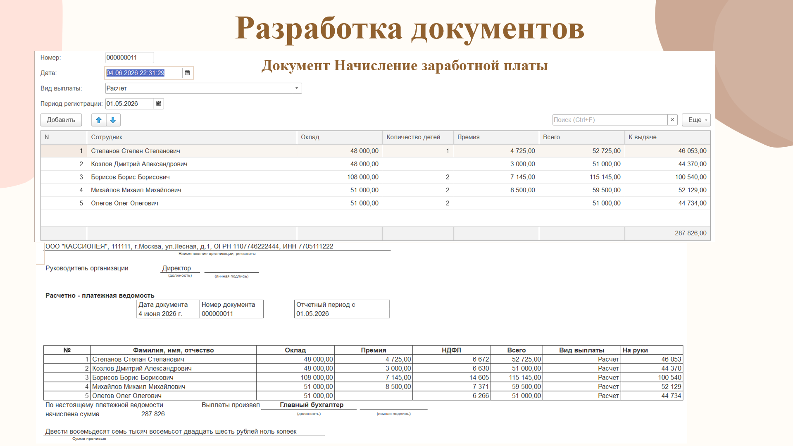
    
  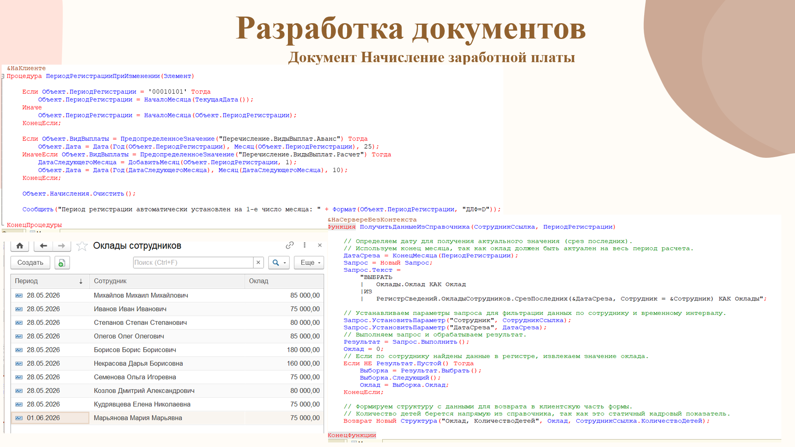
     

  <h3> Отчеты и обработки</h3>
  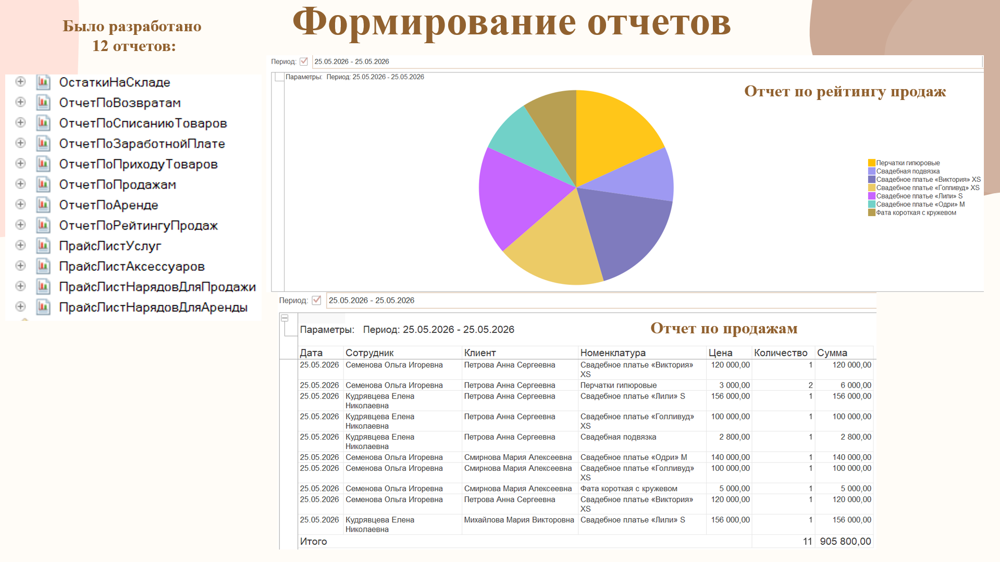
    
  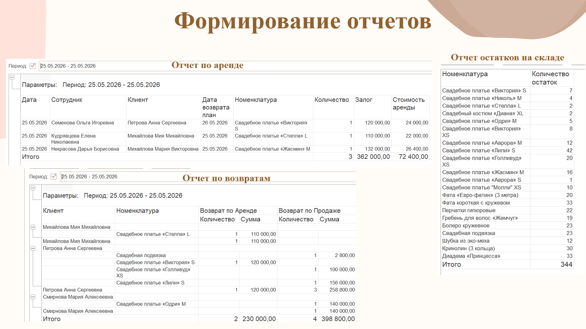
    
  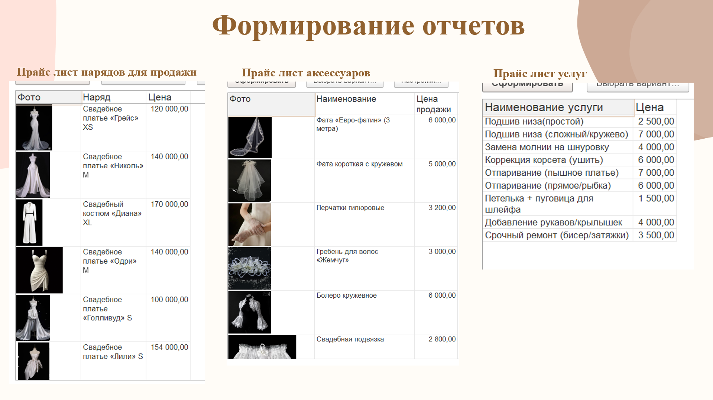
     

  <h3> Дополнительные объекты</h3>
  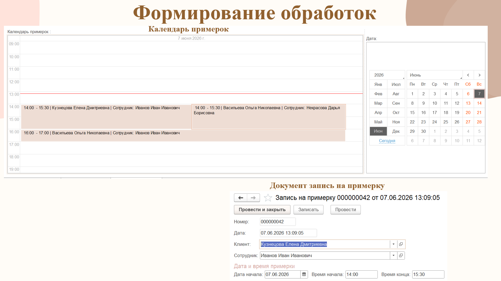
    
  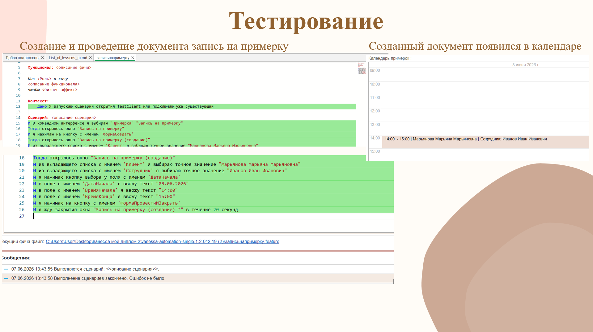
    

 

## О проекте

**Свадебный салон** — это учебная конфигурация, разработанная на платформе **1С:Предприятие 8.5**. Проект создан для автоматизации бизнес-процессов магазина свадебных платьев и аксессуаров. 

Конфигурация позволяет вести учет товаров, управлять клиентской базой, оформлять заказы, а также формировать аналитические отчеты для оценки продаж.

**Ключевой функционал:**
*    **Учет товаров:** ведение номенклатуры (платья, фата, аксессуары, обувь), учет размеров и цветов.
*    **Клиенты:** база клиентов (невесты и женихи), история их покупок и примерок.
*    **Заказы:** оформление заказов, резервирование товаров, отслеживание статуса (в пути, в наличии, продан).
*    **Отчеты:** аналитика продаж, отчет по остаткам на складе, популярные модели.
*    **Обработки:** автоматизация рутинных задач.

  ##  Как развернуть локально

Чтобы запустить проект на своем компьютере:

1.  Скачай файл выгрузки базы данных (`.dt`) из этого репозитория.
2.  Открой платформу **1С:Предприятие 8.5**.
3.  Нажми **Добавить** новую информационную базу.
4.  Выбери **Создание информационной базы без конфигурации**.
5.  Зайди в **Конфигуратор** -> **Администрирование** -> **Загрузить информационную базу...** (и выбери скачанный файл `.dt`).

##  Технологии

*   **Платформа:** 1С:Предприятие 8.5
*   **Язык разработки:** Встроенный язык 1С
*   **Архитектура:** Собственная конфигурация

